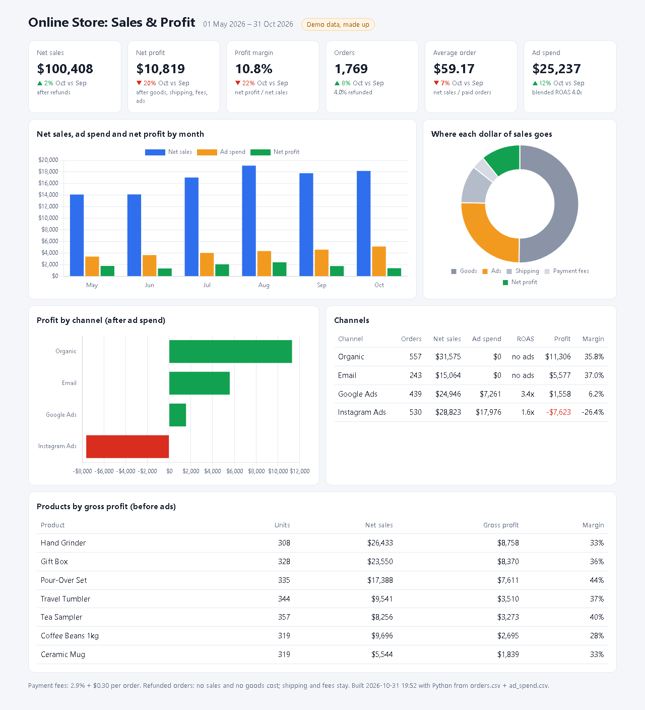

# Sales & Profit Dashboard

**Orders export + ad spend export in, one-page profit dashboard out: real net profit per month, channel and product, after goods, shipping, payment fees, refunds and ads.**

[](https://github.com/zhangir777/sales-profit-dashboard/actions/workflows/ci.yml)

**Hire me:** [Upwork](https://www.upwork.com/freelancers/~012c68804f9b4d4550) · [Fiverr](https://www.fiverr.com/akhmetov_zhangi) · [Telegram @ZhangirAkhmetov](https://t.me/ZhangirAkhmetov)

**Live demo:** https://zhangir777.github.io/sales-profit-dashboard/



*Made-up online store, 6 months, 1,769 orders from [`samples/orders.csv`](samples/orders.csv) and [`samples/ad_spend.csv`](samples/ad_spend.csv).*

## What it shows

- **6 KPIs** with the change vs the previous month: net sales, net profit, margin, orders (and refund rate), average order, ad spend (and blended ROAS).
- **By month:** net sales, ad spend and net profit side by side.
- **Where each dollar goes:** goods, ads, shipping, payment fees, profit.
- **Profit by channel after ad spend**, with ROAS and margin per channel.
- **Products** ranked by gross profit.

The point is the channel view. In the demo, sales look fine, but Instagram Ads have a 1.6x ROAS and **lose $7,623**, while Google Ads (3.4x) make a small profit. Revenue reports don't show that; a profit report does.

## How profit is counted

| Item | Rule |
|---|---|
| Net sales | quantity × price; refunded orders count as 0 |
| Goods | quantity × unit cost; 0 for refunds (the item comes back) |
| Shipping, payment fee | stay even after a refund; fee default 2.9% + $0.30 (`--fee-rate`, `--fee-fixed`) |
| Ads | subtracted from the channel that spent them; Organic and Email carry none |

Works on mobile too: [`docs/screenshots/mobile.png`](docs/screenshots/mobile.png).

## Working with me

Send me your orders export (Shopify, WooCommerce, Kaspi, a spreadsheet) and the ad spend per day and channel. I map your columns and build the dashboard.
**Timeline:** 1–3 days. **Running cost:** $0. The output is one HTML file; you open it locally, or it rebuilds on GitHub Pages / Windows Task Scheduler.

Honest scope: the input is CSV exports, not live API connections. Connecting an API is a separate job.

---

## Technical

Python 3.12+, standard library only. Chart.js is loaded from a CDN in the page.

```bash
uv sync
uv run build-dashboard samples/orders.csv samples/ad_spend.csv --out out/dashboard.html
uv run build-dashboard orders.csv ads.csv --title "My Shop" --fee-rate 0.035 --fee-fixed 0
uv run pytest -q                         # 6 tests
uv run python scripts/make_sample.py     # regenerate the made-up sample
```

| Path | What |
|---|---|
| `dashboard/metrics.py` | loads the CSVs, all profit math, no HTML |
| `dashboard/render.py` | the HTML page (KPIs, charts, tables) |
| `dashboard/cli.py` | command line |
| `docs/index.html` | the built demo served by GitHub Pages |

Input columns: orders `order_id, date, channel, product, quantity, unit_price, unit_cost, shipping_cost, refunded`; ads `date, channel, spend`.

## На русском

Дашборд прибыли для интернет-магазина: из выгрузки заказов и расходов на рекламу делаю одну страницу с чистой прибылью по месяцам, каналам и товарам (с учётом себестоимости, доставки, комиссий, возвратов и рекламы). Видно, какая реклама окупается, а какая работает в минус. Срок 1–3 дня, стоимость работы дашборда $0. Данные в демо выдуманные.
